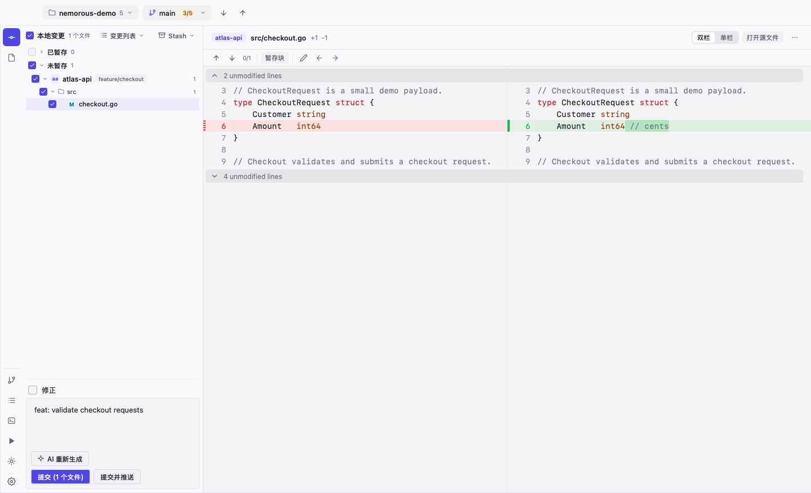
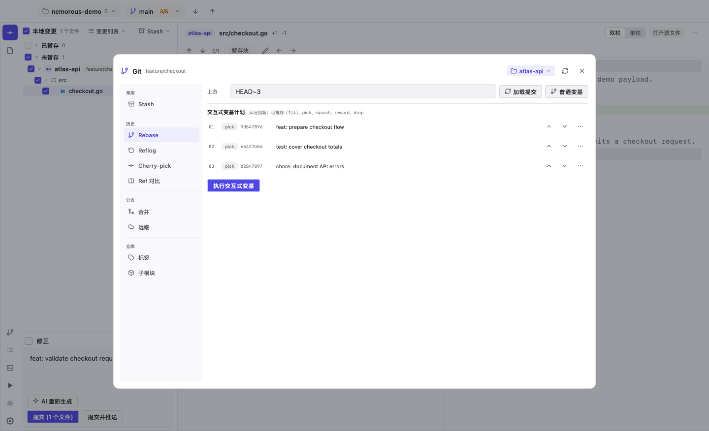
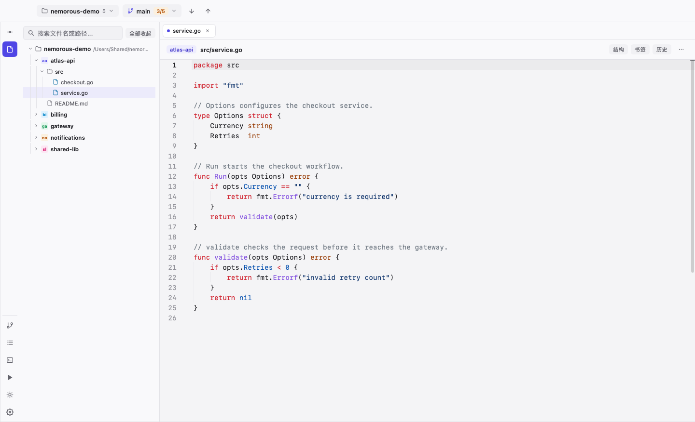
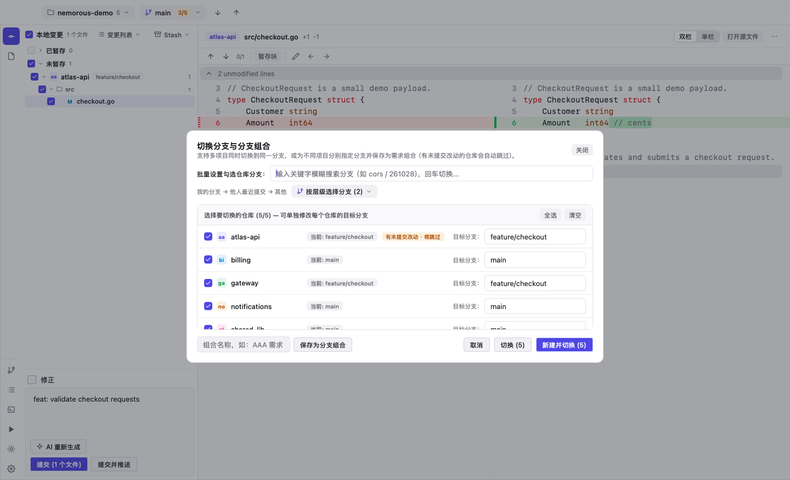

<div align="center">

<a href="https://github.com/iwangjie/Nemorous"></a>

# Nemorous

### A lightweight code reviewer for the AI era

Native, keyboard-first diff review, code navigation, and Git workflow — built in Rust for reviewing AI-generated and human-written changes fast.

[](https://github.com/iwangjie/Nemorous/releases/latest)
[](https://github.com/iwangjie/Nemorous/actions/workflows/ci.yml)
[](LICENSE)
[](Cargo.toml)


<br>

**[Download](https://github.com/iwangjie/Nemorous/releases/latest)** &nbsp;·&nbsp;
**[Why Nemorous](#why-nemorous)** &nbsp;·&nbsp;
**[Features](#features)** &nbsp;·&nbsp;
**[Screenshots](#screenshots)** &nbsp;·&nbsp;
**[Install](#install)** &nbsp;·&nbsp;
**[Shortcuts](#keyboard-shortcuts)** &nbsp;·&nbsp;
**[Build](#build-from-source)** &nbsp;·&nbsp;
**English** · [简体中文](README.zh-CN.md)

</div>



## Why Nemorous

AI coding agents can produce hundreds of lines of changes in seconds. The bottleneck is no longer typing — it is **reviewing, verifying, and landing** code with confidence.

Full IDEs are heavy when all you want is to inspect diffs, trace context, tweak a line, and commit. Plain `git diff` or web PR views lack instant source jumping, micro-editing, and hunk/line staging.

Nemorous is a **lightweight, native code reviewer** built for this workflow:

- **Instant review loop**: IDEA-style staged/unstaged tree, side-by-side or unified diff with synchronized scrolling, syntax highlighting, and inline micro-editing.
- **Seamless diff-to-source**: Jump straight from any diff line to full file context (`F4`), inspect blame or local history, and hop back (`⌘[`) without losing your place.
- **Surgical staging**: Stage, unstage, or roll back individual hunks and selected lines directly from the diff view.
- **Fast code exploration**: File tree, global search, `path:line:column` navigation, bookmarks, and optional on-demand LSP (off by default).
- **Complete Git & PR cockpit**: Commit history across branches, interactive rebase, reflog, branch matrix, GitHub PR/CI views, and a multi-tab terminal.
- **Multi-repo ready**: Scales cleanly from a single repository to multi-repository workspaces when a change spans services.

Built in Rust with the [NSH](https://github.com/longbridge/nsh) native desktop toolkit.

## Features

### Diff & Code Review
- IDEA-style separated **Staged** and **Unstaged** change trees with tri-state checkboxes and keyboard navigation.
- Side-by-side and unified diff modes with synchronized vertical & horizontal scrolling, unchanged-region folding, and whitespace visualization.
- Stage, unstage, or revert by file, hunk, or selected lines directly inside the diff view.
- Direct micro-editing inside the diff pane with undo/redo, local file history, and `F4` / `⌘[` / `⌘]` jump-to-source navigation.
- `F7` / `⇧F7` difference stepping that flows across file boundaries.

### Code Navigation & Optional LSP
- Fast file tree, command palette (`⌘⇧P`), go-to-file (`⌘⇧O` with `path:line:column`), recent files/locations, and global text/regex search (`⌘⇧F`).
- Trackpad pinch-to-zoom font scaling with preserved syntax highlighting.
- **LSP is optional and off by default**, keeping startup instant on large codebases. Enable it in Settings to get completion, hover, go-to-definition, references, diagnostics, inlay hints, formatting, and workspace rename for Go, TypeScript/JavaScript, Python, Rust, C/C++, and Java.

### Git Workflow & Recovery
- Global commit graph/forest with multi-repository filtering, branch filtering, date/path filters, and one-click **"Me"** author filtering.
- Background `⌘T` pull with bottom-right status-bar progress and toast notifications.
- Interactive rebase plan (pick, squash, reword, drop, reorder), reflog recovery, explicit merge strategies (`--no-ff`, `--ff-only`, squash), and `--force-with-lease` push.
- Compare any two refs with two-dot or three-dot diff.
- Worktree-isolated merge workflow with optional AI conflict resolution.

### AI & Terminal Integration
- **Optional local AI CLI**: Connects to `omp`, `pi`, `claude`, or `codex` only on explicit actions (commit message generation from selected patches, merge conflict resolution) — never runs silently in the background.
- **Multi-tab integrated terminal**: Theme-adaptive colors, accurate monospace metrics, tab management, and right-click shell restart.
- **GitHub PR & CI**: Review pull requests, inspect check runs, and post comments right inside the workspace.

### Credentials & Security
- HTTPS credentials delegated to the system Git credential helper (macOS Keychain by default).
- SSH key listing, ed25519 generation, connection testing, and GPG/SSH commit signing.
- Secrets and tokens are never written to Nemorous config files.

## Screenshots

<table>
  <tr>
    <td width="50%"></td>
    <td width="50%"></td>
  </tr>
  <tr>
    <td width="50%"></td>
    <td width="50%"></td>
  </tr>
</table>

## Install

| Platform | Download |
|---|---|
| macOS 13+ (Apple Silicon / Intel) | [Latest Rust release](https://github.com/iwangjie/Nemorous/releases/latest), `.dmg` |
| Windows (arm64 / amd64) | [Go v0.10.21](https://github.com/iwangjie/Nemorous/releases/tag/v0.10.21), `.exe` or `.tar.gz` |
| Linux (arm64 / amd64) | [Go v0.10.21](https://github.com/iwangjie/Nemorous/releases/tag/v0.10.21), `.deb` or `.tar.gz` |

macOS uses the signed update feed. The latest stable release also carries the v0.10.21 update manifests and archives used by the Windows and Linux apps.

## Quick start

1. Open Nemorous and select a repository or workspace directory.
2. Press `⌘0` / `Ctrl+0` to inspect local changes, press `⌘D` to open the diff, and step through hunks with `F7`.
3. Press `F4` on any line to jump into full source context, or `S` / `U` to stage and unstage changes.
4. Write or AI-generate a commit message and press `⌘↩` to commit (`⌘⇧↩` to commit and push).
5. Press `⌘9` for Git history, `⌘B` for the branch matrix, or `⌘⇧O` to jump to any file.

## Keyboard shortcuts

`Cmd` is `Ctrl` on Windows and Linux. `Alt` is `Option` on macOS.

| Shortcut | Action |
|---|---|
| `⌘K` | Focus the commit message / open the commit view |
| `⌘⇧K` | Push repositories with unpushed commits |
| `⌘T` | Pull updates in the background (progress in bottom-right status bar) |
| `⌘↩` | Commit selected files |
| `⌘⇧↩` | Commit and push |
| `⌘0` / `⌘1` / `⌘9` / `⌘4` | Commit / Project / Git / Mani |
| `⌘B` | Branch matrix |
| `⌘⇧P` / `⌘⇧O` | Command palette / go to file, including `path:line:column` |
| `⌘E` / `⌘⇧E` | Recent files / recent locations |
| `⌘⇧F` | Global search |
| `⌘L` | Go to line and column (`Ctrl+G` on Windows and Linux) |
| `⌘F` / `⌘G` / `⇧⌘G` / `⌘R` | Find / next match / previous match / replace in the editor |
| `⌘⌥Y` | Refresh workspace |
| `⌘D` | Open the diff for the selected file |
| `F7` / `⇧F7` | Next / previous difference (crosses file boundaries) |
| `⌥←` / `⌥→` | Previous / next diff file |
| `F4` / `⌘[` / `⌘]` | Jump to source / return to diff / forward to source |
| `⌘S` | Save editor or diff micro-edit |
| `Space` | Toggle selected file checkbox |
| `S` / `U` | Stage / unstage selected file |
| `⌥F7` | Find references (LSP) |
| `⌥↩` | Quick fixes / code actions (LSP) |
| `⌘⌥L` | Reformat current file |
| `⌘⌥Z` | Roll back selected change |

## Optional AI

Nemorous does not ship a model. It uses a locally installed CLI when configured:

```json
{
  "ai_agent": "auto"
}
```

Supported agents: `omp`, `pi`, `claude`, `codex`. AI is invoked only for explicit actions such as commit-message generation or conflict resolution, never in the background.

## Optional LSP

Enable LSP under **Settings → General → Enable Language Server**. Servers start only when a matching file is opened. Override commands in config without changing code:

```json
{
  "lsp_enabled": true,
  "lsp_servers": {
    "go": "/opt/homebrew/bin/gopls",
    "typescript": "typescript-language-server --stdio"
  }
}
```

## Build from source

Building the macOS app requires Rust 1.99+, Git, and Xcode command-line tools.

```bash
git clone https://github.com/iwangjie/Nemorous.git
cd Nemorous
scripts/prepare-nsh.sh
cargo test --locked --release --lib --test domain_git_tests --test headless_review_ui_tests
cargo build --locked --release --bin nemorous
scripts/package-macos-app.sh build/out target/release/nemorous
```

For Linux and Windows Rust entry points, see [platform build notes](platforms/README.md).

## Security

Please report vulnerabilities through [GitHub Security Advisories](https://github.com/iwangjie/Nemorous/security/advisories/new), not a public issue. See [SECURITY.md](SECURITY.md) for scope and handling.

## Contributing

Issues and pull requests are welcome. See [CONTRIBUTING.md](CONTRIBUTING.md) for development setup, test expectations, and code style.

## License

MIT. See [LICENSE](LICENSE).
