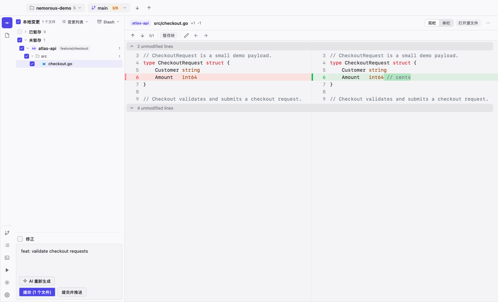
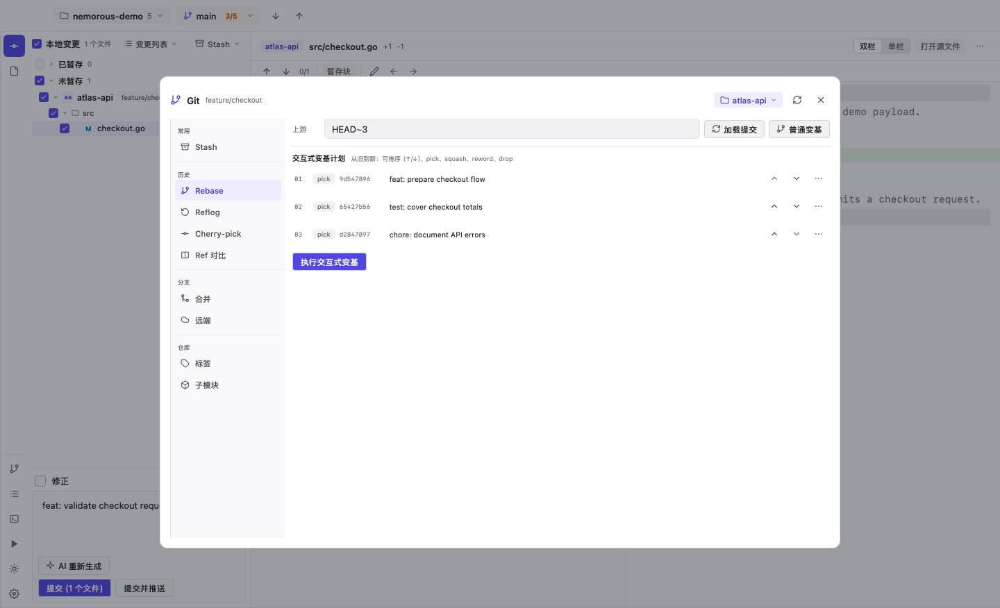
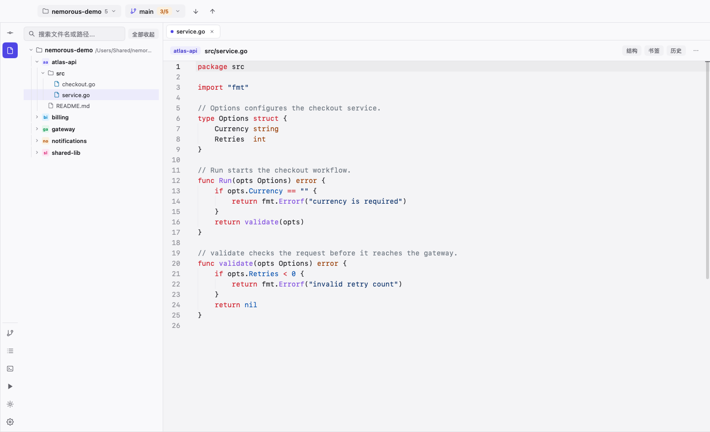
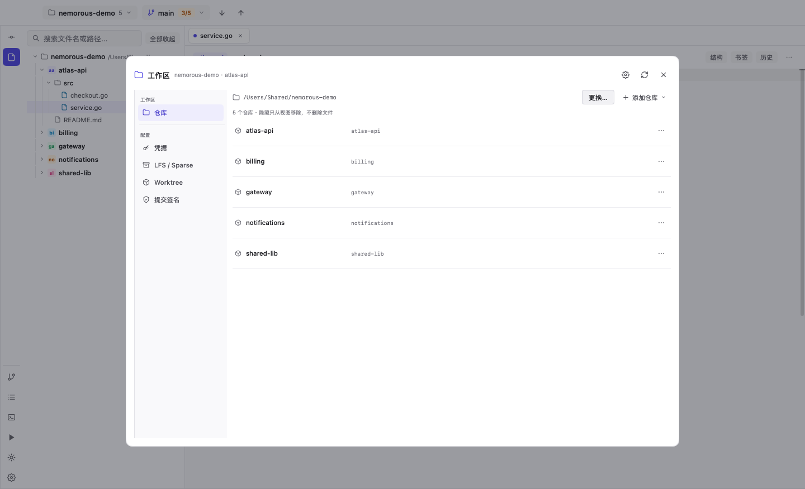
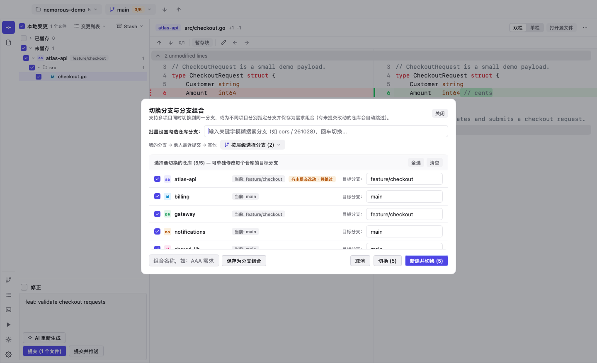

<div align="center">

<a href="https://github.com/iwangjie/Nemorous"></a>

# Nemorous

### Multi-repository Git, without the tab maze

A native, keyboard-first Git cockpit for workspaces where one change spans several repositories.

[](https://github.com/iwangjie/Nemorous/releases/latest)
[](https://github.com/iwangjie/Nemorous/actions/workflows/ci.yml)
[](LICENSE)
[](go.mod)


<br>

**[Download](https://github.com/iwangjie/Nemorous/releases/latest)** &nbsp;·&nbsp;
**[Features](#features)** &nbsp;·&nbsp;
**[Screenshots](#screenshots)** &nbsp;·&nbsp;
**[Install](#install)** &nbsp;·&nbsp;
**[Shortcuts](#keyboard-shortcuts)** &nbsp;·&nbsp;
**[Build](#build-from-source)** &nbsp;·&nbsp;
**English** · [简体中文](README.zh-CN.md)

</div>



## Why Nemorous

Modern products are rarely one repository. A feature can touch an API, a billing service, a shared library and a deployment gateway. Switching between IDE windows to keep branches, stashes, diffs and commits aligned is slow and easy to get wrong.

Nemorous puts the whole workspace in one place:

- **One branch matrix** for every repository, with presets for repeatable feature stacks.
- **One changes tree** with staged/unstaged separation, hunk and line staging.
- **One commit flow** with optional AI-generated messages and batch commit/push.
- **One history view** with interactive rebase, reflog, worktrees and explicit merge strategies.
- **One code surface** with optional LSP diagnostics, references, quick fixes and formatting.
- **One integration layer** for GitHub, GitLab, Jenkins, Kubernetes, databases and more through plugins.

It is built with Go and [MyGo Native UI](https://mygo.egoist.dev/): no Electron, no WebView, no JavaScript UI runtime, and `CGO=0` for simple distribution.

## Features

### Multi-repository workflow
- Branch matrix with ahead/behind, dirty flags and one-click switching.
- Branch presets and per-repository targeting.
- Safe pull with automatic stash/pop and fast-forward-only updates.
- Batch fetch, pull, commit and push with per-repository results.

### Changes and commits
- IDEA-style staged/unstaged tree with tri-state checkboxes and keyboard navigation.
- Side-by-side or unified diff, syntax highlighting, micro-editing and local history.
- Stage/unstage hunks and selected lines directly from the diff toolbar.
- Optional AI commit message generation grounded in the selected patches.
- Amend, revert, cherry-pick, change lists and commit-message history.

### History and recovery
- Global commit forest across repositories.
- Interactive rebase plan: pick, squash, reword, drop and reorder.
- Reflog browser with soft / mixed / hard / keep reset and confirmation.
- Explicit merge strategies: default, `--no-ff`, `--ff-only`, squash.
- Safe force push with `--force-with-lease`.
- Compare any two refs with two-dot or three-dot diff.
- Worktree-isolated merge workflow with AI conflict resolution and verification.

### Code intelligence
LSP is **optional and off by default**, so large repositories do not pay for a language server unless you enable one.

When enabled, installed servers provide:
- completion, hover and go-to-definition
- references and quick fixes
- live diagnostics and a Problems view
- document formatting
- inlay hints
- symbol rename with workspace edits

Built-in detection covers Go, TypeScript/JavaScript, Python, Rust, C/C++, and Java. Commands can be overridden in `lsp_servers` in the config file.

### Workspace and security
- Clone, initialize, import and hide repositories without leaving the app.
- HTTPS credentials through the system Git credential helper; macOS Keychain by default.
- SSH key listing, ed25519 generation, connection testing and SSH commit signing.
- GPG or SSH commit signing per repository.
- Git LFS, sparse checkout and worktree management.
- Secrets are not written to the Nemorous config.

### Integrations
Built-in GitHub PR/CI support, plus official plugins for GitLab, Maven, Java, Markdown, CSV, SSH, Code Stats, Jenkins, Kubernetes, Databases and Bookmarks.

## Screenshots

<table>
  <tr>
    <td width="50%"></td>
    <td width="50%"></td>
  </tr>
  <tr>
    <td width="50%"></td>
    <td width="50%"></td>
  </tr>
</table>

## Install

Download the latest package from **[GitHub Releases](https://github.com/iwangjie/Nemorous/releases/latest)**:

| Platform | Package |
|---|---|
| macOS (Apple Silicon / Intel) | `.dmg` |
| Windows (arm64 / amd64) | `.exe` installer or `.tar.gz` |
| Linux (arm64 / amd64) | `.deb` or `.tar.gz` |

Updates are signed and can install in the background. No separate runtime is required.

## Quick start

1. Open Nemorous and select a workspace directory.
2. Click the workspace name, then **Add repository** to clone, initialize or import a repository.
3. Add an HTTPS token or SSH key under **Credentials** if the remote is private.
4. Select changes, write or generate a commit message, and commit. Use **Commit and Push** for the full flow.
5. Press `⌘3` / `Ctrl+3` for the commit history, or `⌘B` / `Ctrl+B` for the branch matrix.

`mani.yaml` is optional. When present, Nemorous uses it for project names, descriptions and Mani tasks.

## Keyboard shortcuts

`Cmd` is `Ctrl` on Windows and Linux. `Alt` is `Option` on macOS.

| Shortcut | Action |
|---|---|
| `⌘K` | Focus the commit message / open the commit view |
| `⌘⇧K` | Push all repositories with unpushed commits |
| `⌘T` | Update all repositories (fetch + fast-forward pull) |
| `⌘↩` | Commit selected files |
| `⌘⇧↩` | Commit and push |
| `⌘1` / `⌘2` / `⌘3` / `⌘4` | Changes / Files / Git / Mani |
| `⌘B` | Branch matrix |
| `⌘⇧P` / `⌘P` | Command palette / file finder |
| `⌘⇧F` | Global search |
| `⌘R` | Refresh workspace |
| `⌘S` | Save editor or diff micro-edit |
| `Space` | Toggle selected file |
| `S` / `U` | Stage / unstage selected file |
| `⌥F7` | Find references (LSP) |
| `⌥↩` | Quick fixes / code actions (LSP) |
| `⌘⌥L` | Reformat current file |
| `⌘⌥Z` | Roll back selected change |

Git actions are also available from the right-click menus on files, repository groups and commits.

## Optional AI

Nemorous does not ship a model. It uses a locally installed CLI when you configure one:

```json
{
  "ai_agent": "auto"
}
```

Supported agents: `omp`, `pi`, `claude`, `codex`. AI is used only for explicit actions such as commit-message generation or conflict resolution. It is never called in the background.

## Optional LSP

Enable LSP under **Settings → Optional Code Intelligence (LSP)**. Servers are started only when a matching file is opened. Override a command without changing code:

```json
{
  "lsp_enabled": true,
  "lsp_servers": {
    "go": "/opt/homebrew/bin/gopls",
    "typescript": "typescript-language-server --stdio"
  }
}
```

## Build from source

Requirements: Go 1.27+ and Git.

```bash
git clone https://github.com/iwangjie/Nemorous.git
cd Nemorous
go test ./...
go vet ./...
go tool mygo vet .
go tool mygo build
```

Release packaging uses MyGo:

```bash
go tool mygo build -platform darwin/arm64,linux/amd64,windows/amd64
```

## Engineering notes

- Native MyGo UI; no browser engine.
- `CGO_ENABLED=0`; cross-platform single binaries.
- Git operations go through the Git CLI for predictable behaviour and credential-helper compatibility.
- AI and LSP work is bounded by timeouts and result caps.
- CI runs formatting, vet, unit tests and headless UI tests on macOS, Linux and Windows; Linux additionally runs the backend race suite.
- Every release publishes checksums and signed update manifests.

## Security

Please report vulnerabilities through [GitHub Security Advisories](https://github.com/iwangjie/Nemorous/security/advisories/new), not a public issue. See [SECURITY.md](SECURITY.md) for scope and handling.

## Contributing

Issues and pull requests are welcome. Start with [CONTRIBUTING.md](CONTRIBUTING.md) for development setup, test expectations and code style.

## License

MIT. See [LICENSE](LICENSE).
