<div align="center">

<a href="https://github.com/iwangjie/Nemorous">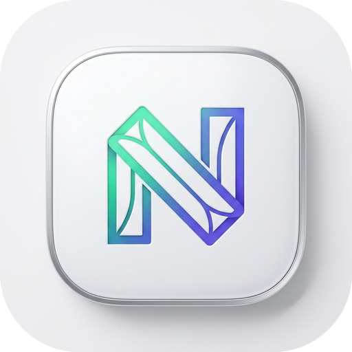</a>

# Nemorous

### 多仓如林 · 统一俯瞰

**专为 AI 编程时代打造的高性能、极低内存占用、秒级启动的多仓库 Git 协同桌面工具**<br>
基于 [MyGo Native UI](https://mygo.egoist.dev/) 构建 · 纯原生 GPU 渲染 · 零 WebView 开销 · `CGO=0` 单二进制跨平台分发

[](https://github.com/iwangjie/Nemorous/releases/latest)
[](https://github.com/iwangjie/Nemorous/actions/workflows/ci.yml)
[](LICENSE)
[](https://goreportcard.com/report/github.com/iwangjie/Nemorous)


<br>

**[下载安装包](https://github.com/iwangjie/Nemorous/releases/latest)** &nbsp;·&nbsp; **[核心特性](#核心特性)** &nbsp;·&nbsp; **[安全不变量](#安全不变量-safety-invariants)** &nbsp;·&nbsp; **[快捷键速查](#快捷键速查)** &nbsp;·&nbsp; **[简体中文](README.zh-CN.md)** · [English](README.md)

<br>

<picture>
  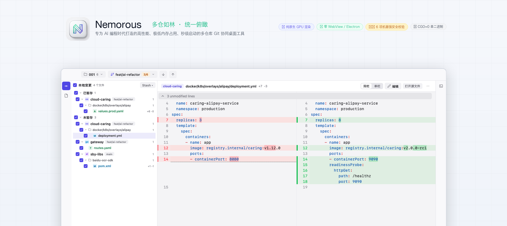
</picture>

<br>

<picture>
  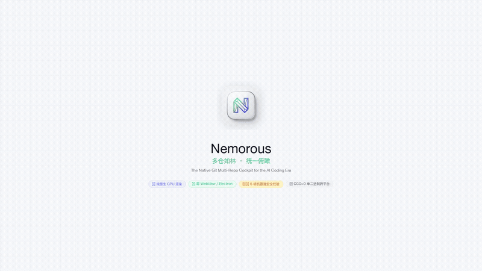
</picture>

<sub>🎬 完整高清宣传片视频文件见 [assets/promo.mp4](assets/promo.mp4)</sub>

</div>

<br>

## 为什么需要 Nemorous？

在多微服务与多仓协同架构中，一次完整的业务特性或重构往往横跨数个甚至数十个关联 Git 仓库（如 `cloud-caring`、`gateway`、`monorepo`、`risk-cloud`、`sby-libs`、`tax-pay-ext` 等）。

进入 AI 编程时代后，开发者与 AI Agent（Claude Code、Codex、Cursor、OpenCode、Pi 等）协同工作，高频痛点已发生剧烈变化：

| 传统痛点 | AI 编程时代加剧的痛点 | Nemorous 的解法 |
|---|---|---|
| **分支漂移** | AI 批量生成跨仓分支，本地切换繁琐，忘记切分支直接修改代码 | **`⌘B` 多仓一键批量切分支**：自动暂存未提交代码、原子快进对齐、记住常用分支组合 |
| **Pull 频繁冲突** | 执行批量 pull 时因本地脏文件被跳过，导致依赖库不同步 | **自动暂存与恢复 (Auto Stash & Pop)**：拉取前自动暂存改动，快进成功后无缝恢复 |
| **审阅碎片化** | 各个 IDE 窗口反复横跳，无法统一纵览改动上下文 | **IDEA 风格单树多仓改动审阅**：统一文件树层级、双栏 Diff、单行行级微调（`⌘S` 保存） |
| **合并风险高** | 跨仓合入测试/主干分支，污染本地工作区或误破坏代码 | **Worktree 隔离合并**：合并在独立临时工作区执行，工作区 100% 保持纯净 |
| **AI 冲突解决黑盒** | AI 解冲突容易越界乱改无关文件、引入幻觉或遗漏冲突标记 | **6 项机器强安全校验 (`VerifyAIMerge`)**：边界校验、哈希双亲匹配、0 残留冲突标记扫描 |
| **内存与卡顿** | 启动多个 Electron 工具导致系统内存吃紧、风扇狂转 | **纯原生 GPU 渲染 (Metal/D3D11/OpenGL)**：秒级启动、20MB 超低常驻内存、0ms WebView 开销 |

---

## 核心特性

### 1. 多仓一键分支对齐与原子拉取 (`⌘B`)
- **多仓分支矩阵**：一目了然查看所有仓库的当前分支、领先/落后远端提交数、未提交改动状态。
- **一键统一切换**：输入分支名（支持 RE2 正则与模糊检索），勾选仓库一键切到同一分支或基准分支。
- **记住分支组合 (Branch Presets)**：保存复杂业务特性的多仓分支映射方案，顶栏一键恢复方案。
- **防踩坑保护**：有未提交改动的仓库自动安全跳过或自动 Stash；严禁在有风险状态下强制检出。

<picture>
  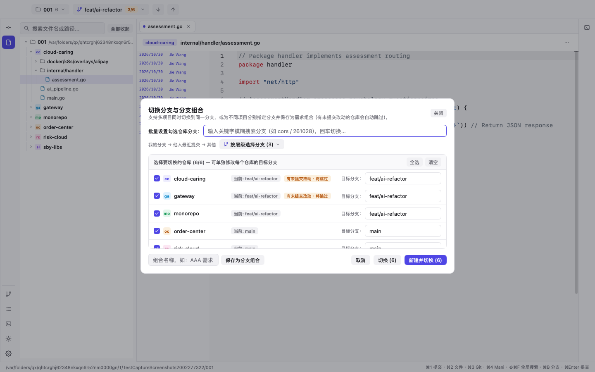
</picture>

---

### 2. IDEA 风格多仓变更树与行级微调 (`⌘1`)
- **精细化层级文件树**：严格规范 `仓库 → 目录 → 文件` 树形缩进，目录自动收缩合并（Compact Middle Packages）。
- **三态复选框**：支持仓库级、目录级与文件级勾选；Shift 连选；按 `Space` 切换勾选，按 `S` 暂存，按 `U` 取消暂存。
- **统一/双栏 Diff 查看器**：高亮新增/修改/删除，支持在 Diff 视图内直接光标编辑微调，按 `⌘S` 实时落盘。
- **统一提交与推送**：支持跨多个仓库一键执行 Unified Commit，支持 `--amend`，支持撤销上一次提交 (`git reset --soft`)。

<picture>
  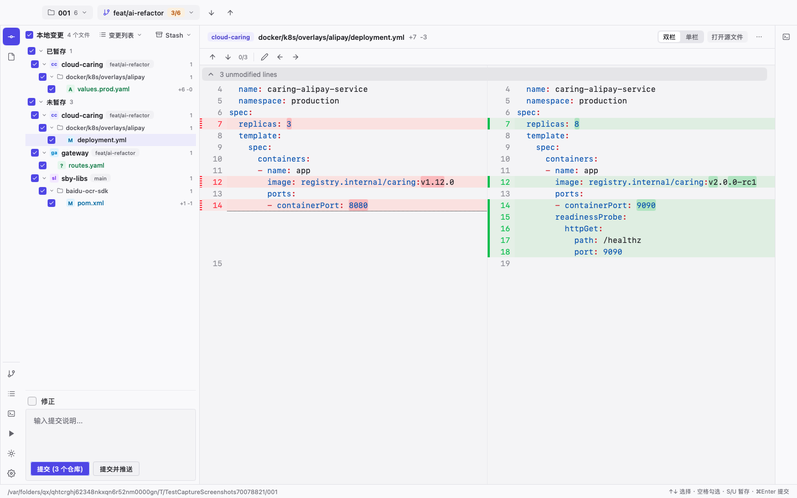
</picture>

---

### 3. 免索引毫秒级代码查阅与 Git Blame (`⌘2`)
- **零索引冷启动**：秒级载入百万行代码库，免去大型 IDE 漫长索引等待。
- **全局文件极速模糊检索 (`⌘P` / `⌘K`)**：毫秒级跨仓定位文件。
- **30+ 语言语法高亮**：原生 GPU 着色渲染，平滑滚动无掉帧。
- **IDEA 风格 Git Blame**：整文件左侧日期/作者注解，近期提交时间热力着色；单击行尾单行浮动注解，点击直接下钻跳转对应提交详情。

<picture>
  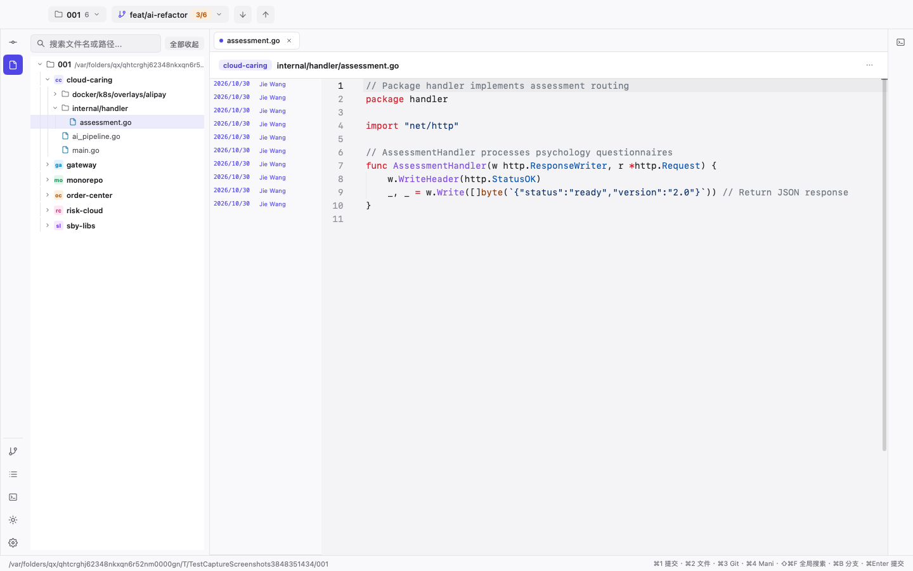
</picture>

---

### 4. 全局提交森林与多仓泳道 (`⌘3`)
- **统一提交森林**：所有仓库的提交历史按时间统一拓扑排序，汇入同一棵全局树。
- **彩色全局泳道**：最多展示 10 条活跃多仓泳道，溢出泳道优雅折叠，杜绝蜘蛛网式长连线。
- **全能提交筛选**：支持按文本/SHA、仓库、分支、作者（“我”的提交优先）、路径目录及 Ripgrep Glob 检索。

<picture>
  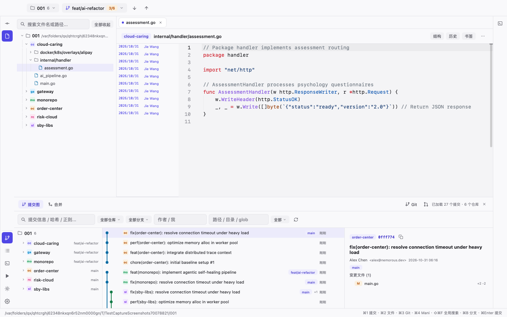
</picture>

---

### 5. Worktree 隔离合并与 AI 冲突消解
- **工作区零污染**：合并完全在后台临时 `git worktree` 中运行，当前工作区的未提交代码不受丝毫影响。
- **无冲突秒级合入**：自动快进更新目标分支并推送；
- **AI 智能解冲突**：支持接入本地 `pi` / `claude` / `codex` / `omp` CLI 辅助消解代码冲突；
- **6 项机器强安全校验**：所有 AI 合并成果必须 100% 通过纯机器严格校验才允许入库（详见下文）。

---

### 6. 原生集成 `mani.yaml` 与 `AGENTS.md` (`⌘4`)
- **Mani 任务面板**：自动发现多仓工程中的 `mani.yaml` 规范，一键运行构建、测试、部署命令；右键仓库可针对特定项目执行。
- **AGENTS 规则感知**：自动识别根目录与各子仓下的 `AGENTS.md` 职责与 AI 规范。

---

### 7. 内置 PTY 原生终端与全局命令面板
- **内置 Ghostty 终端**：按 `⌘3` / `nav-terminal` 唤起全功能原生 PTY 终端模拟器，无缝执行 Git 与系统命令。
- **全局内容搜索 (`⇧⌘F`)**：跨仓库多线程全文检索，优先调用本机 `rg` (Ripgrep) 加速，未安装时自动无缝回退内置引擎。

---

### 8. 插件引擎、插件市场与官方工具窗口
- **沙箱化插件引擎**：插件是带 `plugin.json` 清单的 JavaScript 包，运行在内置 goja VM 中。工具窗口与命令面板入口由声明式 UI 树驱动；文件、进程、HTTP、编辑器与终端能力必须显式声明权限。
- **完整安装器与插件市场**：内置官方索引 + 远程市场，支持安装、更新、启用、禁用、卸载与本地 `.zip` 安装；远程包强制 SHA-256 校验，压缩包做体积与路径越界检查，内置插件离线可用。
- **官方 Maven 插件（为大型多仓 Reactor 设计）**：跨全部仓库发现 Maven 模块，按父子/模块关系组织，计算构建批次与版本冲突，展示跨仓内部依赖边；支持 `clean/compile/test/package/install`、默认并发构建（`-T 1C`）、项目 wrapper、Maven/JVM 设置、实时输出、`dependency:tree` 与 Effective POM。
- **官方 Java 插件**：扫描工作区 `src/main/java` 与 `src/test/java`，识别主类/测试类，通过 Maven/Gradle 或原生 `java` 运行并流式输出，可开启 JDWP 端口供远程调试。
- **官方 Jenkins 插件**：连接公司 Jenkins，自动处理 Session Cookie 与 CSRF；浏览文件夹与常见任务类型，支持搜索、仓库关联、参数化构建、队列/构建状态轮询、构建历史与控制台输出。
- **官方 Kubernetes 插件**：原生 K8s Dashboard，查看命名空间、Pod、Deployment、StatefulSet、Service、Ingress、事件与节点；流式查看 Pod 日志、扩缩容、滚动重启，无需 kubectl。
- **官方预览与远程插件**：Markdown/CSV 默认以主编辑器视图打开（Markdown 语法高亮、双栏/单栏/实时预览、本地图片与保存；CSV 表格与搜索）；公司 GitLab 私服 MR/流水线/Issue；代码行数统计与语言分布；SSH 主机保存并直接在底部终端连接。

<picture>
  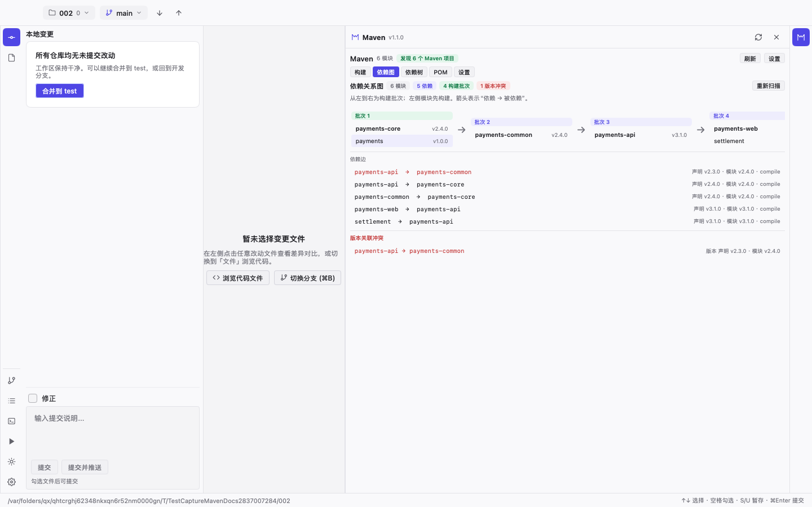
  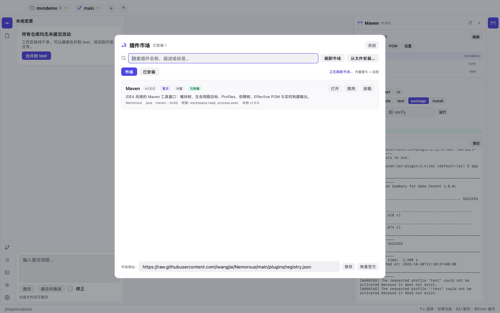
</picture>

<picture>
  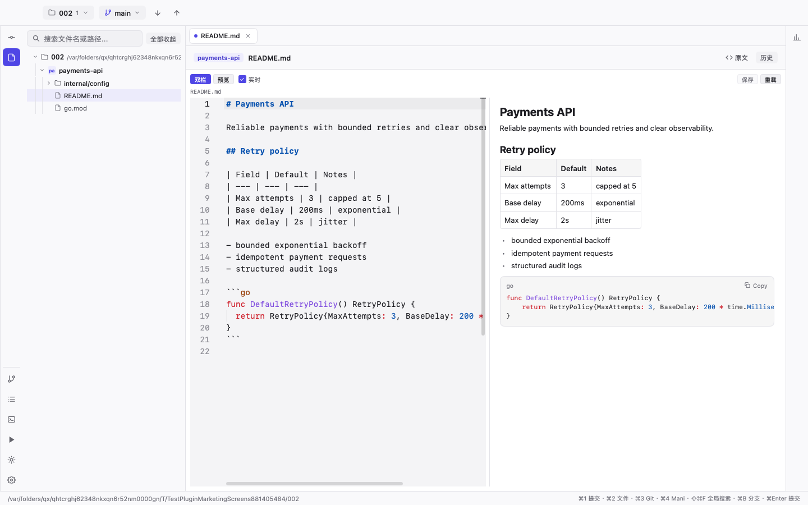
  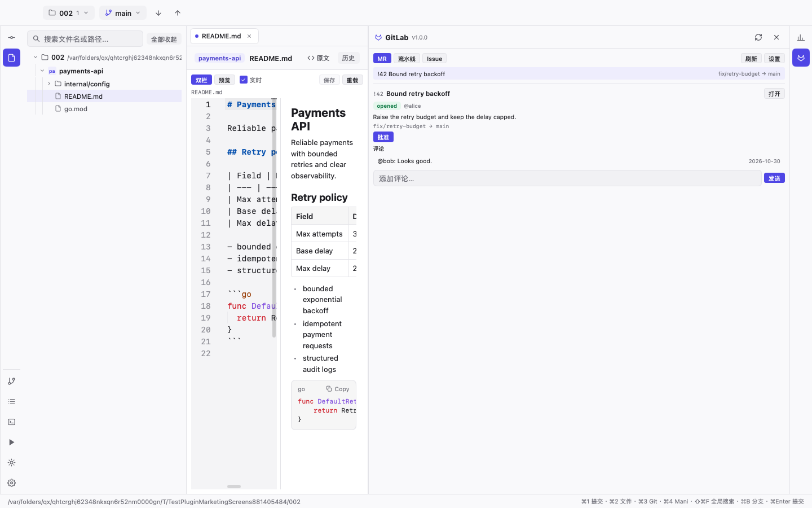
</picture>

<picture>
  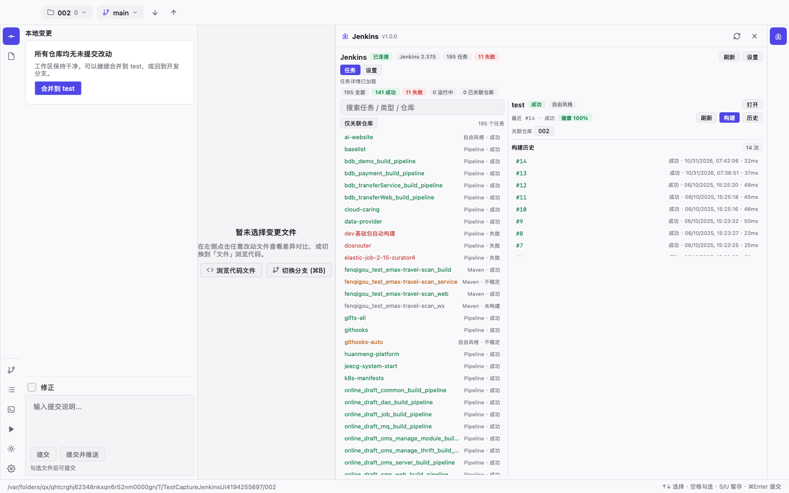
  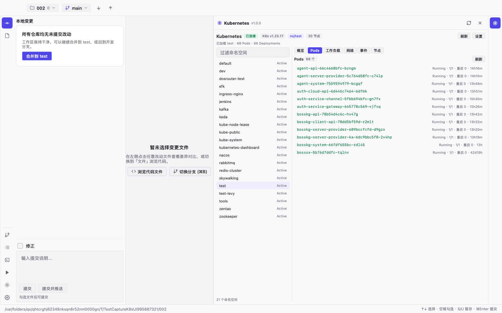
</picture>

插件开发指南：[docs/plugins.md](docs/plugins.md)。

---

### 9. Git 工作流闭环：Stash、Rebase、冲突、变更列表与本地历史
- **Stash 管理**：创建（可含未跟踪文件）、应用、弹出、删除，并查看说明与时间。
- **高级 Git**：Rebase / Cherry-pick / Revert，冲突后可继续或中止；标签创建/删除/推送；Remote 添加/改地址/删除；子模块查看、初始化更新、同步、添加与移除。
- **三栏冲突解决工作台**：Ours / Result / Theirs 左中右三栏，按 Git 操作显示正确语义，逐块 Ours/Theirs/Both/Base、整文件版本、删除/修改与二进制冲突、CRLF 保留、按文件草稿、关闭确认、自动载入下一个文件。**自动合并**安全合并不重叠行修改、保留真实冲突并可撤销，详见 [docs/conflict-resolution.md](docs/conflict-resolution.md)。
- **变更列表**：按需求分组未提交文件，移动勾选文件、过滤变更树、文件行展示列表徽章。
- **本地历史**：打开、保存、格式化、提交、还原前自动快照；浏览并一键恢复，每文件保留 30 份。

<picture>
  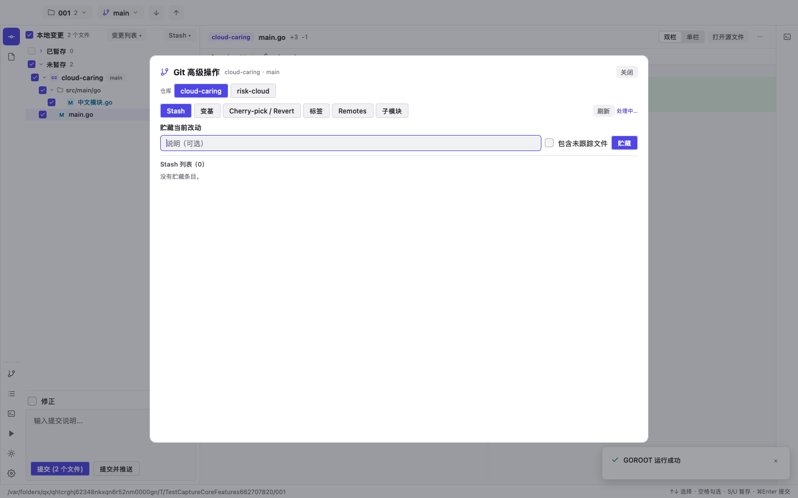
  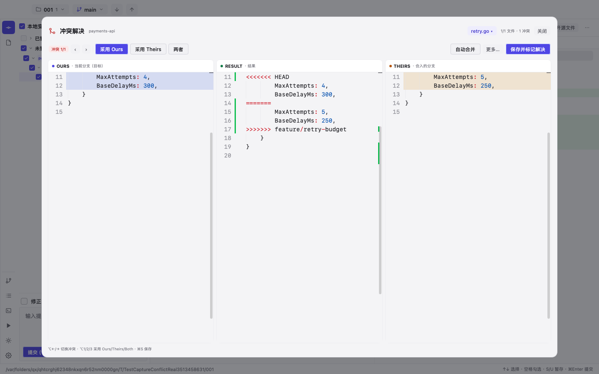
</picture>

---

### 10. GitHub PR / CI / 代码审查评论
- **Pull Requests**：按仓库查看 Open/Closed PR、标题、分支与审查结论。
- **CI Checks**：成功/失败/等待徽章，点击跳转检查详情。
- **评论**：PR 评论与行内 review comments、添加评论、浏览器打开、为当前分支新建 PR。通过本机 `gh` CLI，应用不保存 token。

<picture>
  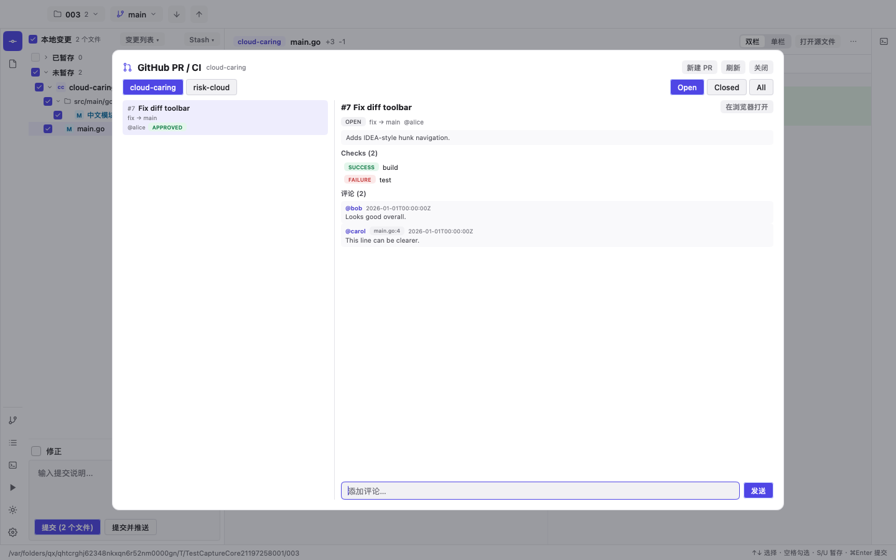
</picture>

---

### 11. 运行 / 测试 / 调试、编辑器增强与多窗口
- **运行配置**：保存 Run/Test/Debug 命令、工作目录、参数与环境变量；流式输出、退出码与停止。
- **DAP 调试器**：支持 stdio/TCP 调试适配器、行号栏持久断点、调用栈、变量与继续/单步/暂停，详见 [docs/run-debug.md](docs/run-debug.md)。
- **编辑器增强**：文件结构大纲、跨仓 TODO/FIXME、书签与行号标记、按语言格式化与保存时格式化；多光标、列选择与代码折叠沿用原生编辑器。
- **会话与多窗口**：启动恢复打开文件、光标、激活视图与分栏；可新建独立窗口并在另一工作区打开。

<picture>
  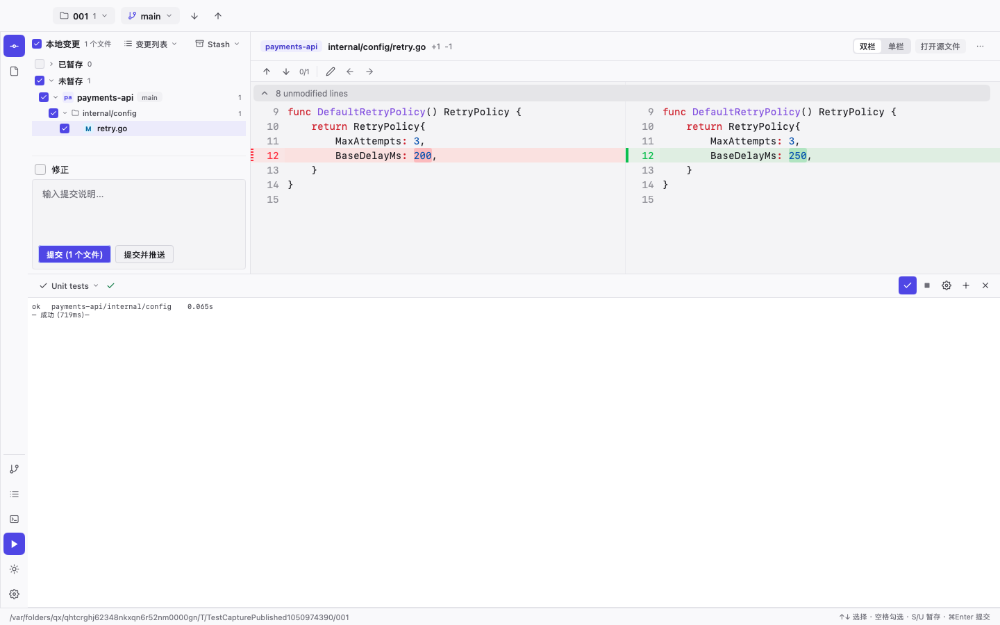
  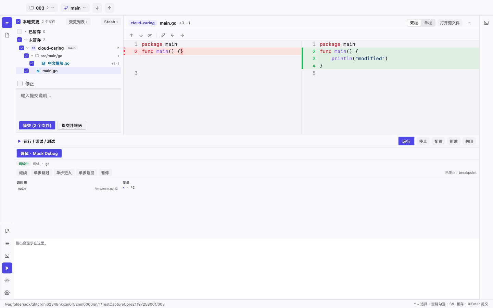
</picture>

---

## 安全不变量 (Safety Invariants)

在工程实践中，自动化工具与 AI 最致命的问题是“毁坏代码”或“误推历史”。Nemorous 在底层架构上确立了严密的数学级安全不变量：

```
                    ┌────────────────────────────┐
                    │      执行前置安全校验       │
                    │  (目标分支存在 / 无非法检出) │
                    └─────────────┬──────────────┘
                                  │
                                  ▼
                    ┌────────────────────────────┐
                    │  临时 Worktree 隔离合并空间 │  ◄── 零触碰本地工作区
                    └─────────────┬──────────────┘
                                  │
                    ┌─────────────┴──────────────┐
                    │                            │
             [无冲突直接提交]              [发生代码冲突]
                    │                            │
                    │                   AI 辅助冲突消解 (CLI)
                    │                            │
                    │                            ▼
                    │            ┌───────────────────────────────┐
                    │            │   6 项机器强安全校验           │
                    │            │   VerifyAIMerge Invariants    │
                    │            ├───────────────────────────────┤
                    │            │ 1. MERGE_HEAD 清理验证         │
                    │            │ 2. git diff --diff-filter=U=0 │
                    │            │ 3. git status porcelain 纯净  │
                    │            │ 4. HEAD 双亲精确匹配           │
                    │            │ 5. 变更集边界严格收敛          │
                    │            │ 6. 0 残留 <<<<<<< 冲突标记     │
                    │            └───────────────┬───────────────┘
                    │                            │ (全部通过)
                    ▼                            ▼
            ┌────────────────────────────────────────────┐
            │          人工确认后安全推送远端             │
            │          (严格禁止 --force / 破坏性参数)     │
            └────────────────────────────────────────────┘
```

1. **绝对保护本地未提交代码**：批量切换分支、拉取更新遇到本地脏文件时自动安全跳过或暂存，绝对不强制覆盖；还原改动强制二次确认弹窗。
2. **严禁破坏性强制推送**：任何推送操作底层彻底封禁 `--force` 与 `--force-with-lease`；`--amend` 导致落后时由开发者自主决定。
3. **撤销提交严格限定**：仅支持安全撤销 (`reset --soft`) 尚未推送到远端的本地提交，已推送历史直接被安全拒绝。
4. **AI 合并 6 项机器强安全校验 (`VerifyAIMerge`)**：
   - **Check 1**：`MERGE_HEAD` 必须清理完毕，确保合并已完成提交；
   - **Check 2**：`git diff --diff-filter=U` 必须精确为 0，杜绝任何未决冲突文件；
   - **Check 3**：`git status --porcelain` 临时工作区必须完全干净；
   - **Check 4**：`HEAD` 必须为双亲提交，且精确匹配 `[preTargetSHA, sourceTipSHA]`；
   - **Check 5**：变更集边界强校验：AI 修改的文件必须严格属于双边分支变更集的并集，严禁越界修改无关文件；
   - **Check 6**：全量内容扫描，确保无任何 `<<<<<<<`、`=======`、`>>>>>>>` 或 `|||||||` 残留冲突标记。

---

## 快捷键速查

| 快捷键 | 视图 / 动作 | 说明 |
|---|---|---|
| `⌘1` | **变更差异与提交** | 多仓变更层次文件树、Diff 对比、行级微调、暂存与提交 |
| `⌘2` | **代码极速查阅** | 零索引毫秒查阅、30+ 语言高亮、Git Blame 注解与提交跳转 |
| `⌘3` | **Git 提交森林 / 终端** | 全局提交拓扑泳道树、分支管理、Worktree 隔离合并 |
| `⌘4` | **Mani 任务面板** | `mani.yaml` 任务与工程快捷执行（未配置时自动隐藏） |
| `⌘K` / `⌘P` | **全局命令面板** | 跨仓文件、改动项、分支动作、Mani 任务一键瞬时检索 |
| `⇧⌘F` | **全局文件内容查找** | 类似 IDEA 的 Find in Files：多仓全文搜索，优先调用 `rg` |
| `⌘B` | **多仓批量切分支** | 多仓分支矩阵切换、创建特性分支、管理分支组合 |
| `⌘⏎` | **提交勾选改动** | 提交勾选的改动文件，支持 `--amend` |
| `⌘⇧⏎` | **提交并安全推送** | 跨仓库一键提交并推送至对应远端（严格禁止 force） |
| `↑` / `↓` | **选中变更文件** | 变更树无焦点时快速上下移动选中文件 |
| `Space` | **勾选 / 取消勾选** | 切换当前选中文件的复选框状态 |
| `S` / `U` | **暂存 / 取消暂存** | 单键快速将选中文件暂存 (Stage) 或取消暂存 (Unstage) |
| `⌘S` | **保存微调** | 将 Diff 或代码查看器内的行级编辑即时安全写入磁盘 |
| `⌘R` | **全局刷新** | 重新扫描并原子更新所有关联 Git 仓库状态 |
| `⌘,` | **全局偏好设置** | 配置工作区路径、外观主题、AI Agent CLI、检查更新间隔 |
| `⌘+` / `⌘-` / `⌘0` | **全局窗口缩放** | 界面等比例放大 (+10%)、缩小 (-10%) 或重置原始比例 (100%) |
| `⌥←` / `⌥→` | **冲突导航** | 合并工作台中上一个/下一个冲突块 |
| `⌥1` / `⌥2` / `⌥3` | **采用冲突侧** | 当前冲突块采用 Ours / Theirs / 两者 |
| `⌘⇧B` | **行书签** | 切换当前编辑器行的书签 |
| `⌘⇧O` | **文件结构** | 当前文件的符号大纲 |
| `⌘⇧T` | **TODO / FIXME** | 跨工作区扫描待办标记 |

---

## 下载与安装

请前往 [GitHub Releases](https://github.com/iwangjie/Nemorous/releases/latest) 下载对应系统平台的最新稳定安装包：

| 平台 | 安装包格式 | 架构支持 | 说明 |
|---|---|---|---|
| **macOS** | `.dmg` | Apple Silicon (`arm64`) & Intel (`amd64`) | 内置 Metal GPU 渲染，首次打开如遇安全提示请右键选择“打开” |
| **Windows** | `-setup.exe` / `.tar.gz` | `amd64` / `arm64` | Direct3D 11 原生加速，NSIS 安装包 |
| **Linux** | `.deb` / `.tar.gz` | `amd64` / `arm64` | OpenGL 原生加速，支持 Ubuntu、Debian 等各大发行版 |

### 签名自动更新机制
- **Ed25519 签名防护**：所有版本清单与更新包均由开发团队私钥签名，客户端内置公钥验签；
- **后台智能更新**：前台定时检查（设置中支持配置 5 分钟至 24 小时）；应用处于非前台且无未保存编辑或运行时，自动后台静默安装并重启；
- **国内加速镜像回退**：内置 `ghfast.top` 镜像加速，并在镜像失效时自动无缝回退 GitHub Releases 官方源。

---

## 源码构建与开发

本项目基于 Go 与 [MyGo](https://mygo.egoist.dev/) 构建，无需 CGO，支持纯静态跨平台编译：

```bash
# 1. 克隆代码库
git clone https://github.com/iwangjie/Nemorous.git
cd Nemorous

# 2. 静态生命周期校验 (MyGo Vet)
go tool mygo vet .

# 3. 运行全部单元测试与无头 UI 自动化回归测试
CGO_ENABLED=0 go test -v ./...

# 4. 构建当前平台的原生桌面发布包 (.app / .dmg / .exe / .deb)
go tool mygo build
```

---

## 许可证

本项目采用 [MIT 许可证](LICENSE)。欢迎提交 Issue 与 Pull Request 共同构建 AI 时代最高效的开源多仓 Git 生产力工具！

<div align="center">
  <sub>Built with ❤️ by the Nemorous Open Source Team · 多仓如林，统一俯瞰</sub>
</div>
