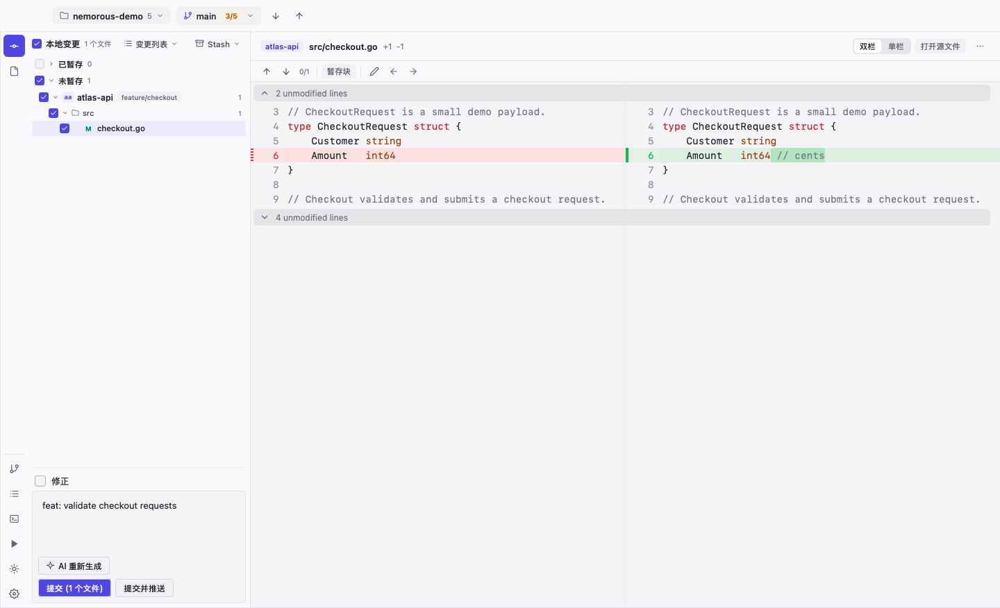
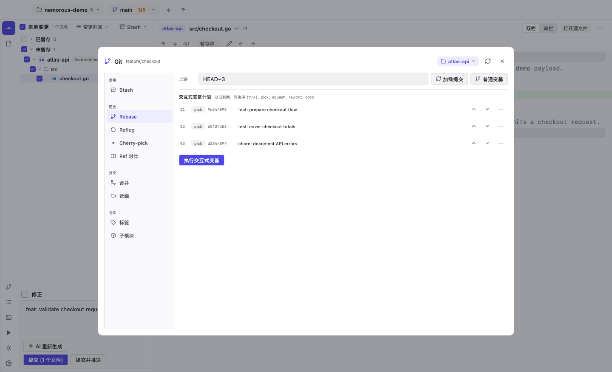
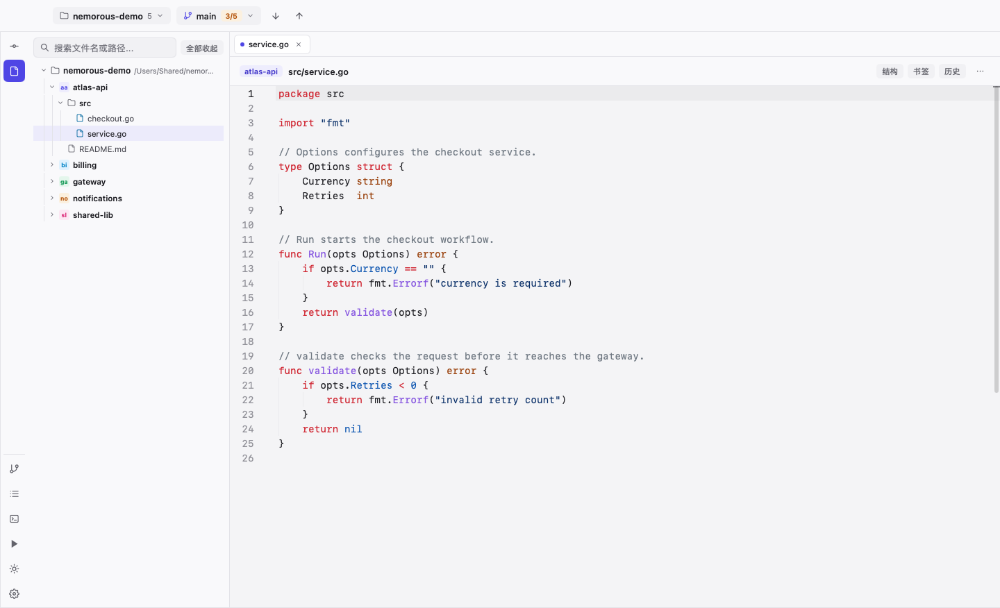
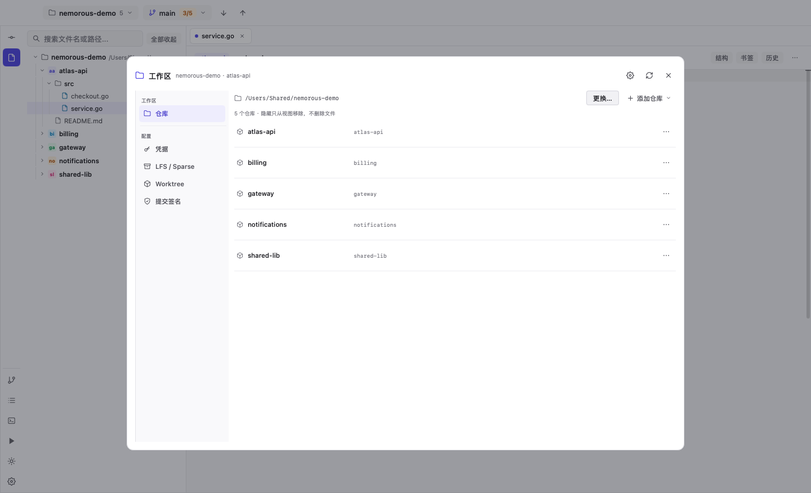
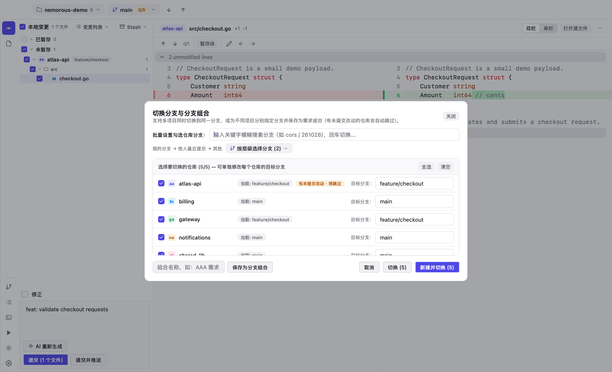

<div align="center">

<a href="https://github.com/iwangjie/Nemorous"></a>

# Nemorous

### AI 时代的轻量级代码审阅器

原生、键盘优先的代码 Diff 审阅、源码跳转与 Git 工作台 —— 基于 Rust 构建，帮你更快审阅 AI 生成与人工编写的每一行改动。

[](https://github.com/iwangjie/Nemorous/releases/latest)
[](https://github.com/iwangjie/Nemorous/actions/workflows/ci.yml)
[](LICENSE)
[](Cargo.toml)


<br>

**[下载](https://github.com/iwangjie/Nemorous/releases/latest)** &nbsp;·&nbsp;
**[为什么用 Nemorous](#为什么用-nemorous)** &nbsp;·&nbsp;
**[核心功能](#核心功能)** &nbsp;·&nbsp;
**[界面截图](#界面截图)** &nbsp;·&nbsp;
**[安装](#安装)** &nbsp;·&nbsp;
**[快捷键](#快捷键)** &nbsp;·&nbsp;
**[从源码构建](#从源码构建)** &nbsp;·&nbsp;
[English](README.md) · **简体中文**

</div>



## 为什么用 Nemorous

在 AI 时代，Agent 几秒钟就能写出数百行代码，开发者的瓶颈不再是「写代码」，而是**审阅、验证并放心合入改动**。

为了看一次 Diff、查一下上下文、微调几行代码并提交，打开笨重的完整 IDE 太慢；而命令行 `git diff` 或网页端 PR 视图又缺少即时源码跳转、微编辑和块/行级暂存。

Nemorous 是专为这种工作流打造的**轻量级原生代码审阅器**：

- **极速审阅闭环**：IDEA 风格的「已暂存 / 未暂存」分区树，双栏/单栏 Diff 支持上下左右同步滚动、语法高亮与直接微编辑。
- **Diff 与源码无缝切换**：在 Diff 任意行按 `F4` 直达完整源码上下文，随时查看 Blame 或本地历史，再按 `⌘[` 原路返回。
- **精细化暂存与回滚**：在 Diff 视图内按文件、变更块（Hunk）或选中行直接暂存、取消暂存或还原。
- **轻快的代码浏览**：内置文件树、全局正则搜索、`路径:行号:列号` 跳转、书签，以及按需开启的 LSP（默认关闭，不拖慢大仓库）。
- **完整的 Git 与 PR 工具链**：提交图历史、交互式 Rebase、Reflog 恢复、分支矩阵、GitHub PR/CI 视图与多标签内置终端。
- **单仓/多仓皆宜**：既适合日常单仓库快速审阅，也能无缝覆盖跨多个服务仓库的协同改动。

基于 Rust 与 [NSH](https://github.com/longbridge/nsh) 原生桌面工具包构建。

## 核心功能

### Diff 与代码审阅
- IDEA 风格的**已暂存的更改 / 未暂存的更改**独立分区树，支持三态勾选与键盘导航。
- 双栏对比 / 单栏内联 Diff，支持上下左右同步滚动、未改动区域折叠与空白字符显示。
- 在 Diff 视图中直接按块（Hunk）或按行暂存、取消暂存与回滚。
- 支持在 Diff 面板中直接微编辑并保存，支持本地历史对比、`F4` / `⌘[` / `⌘]` 源码往返跳转。
- `F7` / `⇧F7` 逐处浏览差异，到达文件末尾后自动切换下一文件。

### 代码浏览与可选 LSP
- 文件树、命令面板（`⌘⇧P`）、转到文件（`⌘⇧O`，支持 `路径:行号:列号`）、最近文件/位置与全局搜索（`⌘⇧F`）。
- 触控板双指捏合缩放代码字号，行距同步缩放且保留语法高亮。
- **LSP 默认关闭**，不让大仓库白白承担语言服务开销。在设置中启用后，可为 Go、TypeScript/JavaScript、Python、Rust、C/C++、Java 提供补全、悬停、跳转定义、查找引用、实时诊断、Inlay Hints、格式化与重命名。

### Git 工作流与恢复
- 全局 Commit Graph / Forest，支持**多仓库多选筛选**、分支/日期/路径筛选，以及作者筛选一键选中**「我」**。
- `⌘T` 后台拉取更新，在右下角状态栏显示实时进度条，完成后弹出通知结果。
- 交互式 Rebase（pick、squash、reword、drop、调整顺序）、Reflog 浏览恢复、显式合并策略（`--no-ff`、`--ff-only`、squash）及 `--force-with-lease` 安全强推。
- 任意两个 ref 的双点 / 三点差异对比；Worktree 隔离合并与可选 AI 冲突解决。

### AI 辅助与集成终端
- **可选本地 AI CLI**：仅在明确操作时调用本机安装的 `omp`、`pi`、`claude` 或 `codex`（如基于选中 Patch 生成提交说明、辅助解决合并冲突），绝不后台静默请求。
- **多标签集成终端**：自动适配浅色/深色主题配色，精准等宽字符渲染，支持标签切换、标签右键重启 Shell 及 `+` 新建标签。
- **GitHub PR 与 CI**：应用内直接查看 Pull Request、检查 CI 状态并发表评论。

### 凭据与安全
- HTTPS 凭据交由系统 Git credential helper（macOS 默认钥匙串）。
- SSH 密钥管理、ed25519 生成、连通性测试及 GPG / SSH 提交签名。
- 密钥与 Token 永不写入 Nemorous 配置文件。

## 界面截图

<table>
  <tr>
    <td width="50%"></td>
    <td width="50%"></td>
  </tr>
  <tr>
    <td width="50%"></td>
    <td width="50%"></td>
  </tr>
</table>

## 安装

| 平台 | 下载 |
|---|---|
| macOS 13+（Apple Silicon / Intel） | [最新 Rust 正式版](https://github.com/iwangjie/Nemorous/releases/latest)，`.dmg` |
| Windows（arm64 / amd64） | [Go v0.10.21](https://github.com/iwangjie/Nemorous/releases/tag/v0.10.21)，`.exe` 或 `.tar.gz` |
| Linux（arm64 / amd64） | [Go v0.10.21](https://github.com/iwangjie/Nemorous/releases/tag/v0.10.21)，`.deb` 或 `.tar.gz` |

macOS 通过签名清单获取更新。最新正式版同时保留 Windows 和 Linux 客户端使用的 v0.10.21 更新清单与归档包。

## 快速开始

1. 打开 Nemorous，选择本地仓库或工作区目录。
2. 按 `⌘0` / `Ctrl+0` 查看本地变更，选中文件按 `⌘D` 打开 Diff，用 `F7` 逐处审阅。
3. 在任意行按 `F4` 跳到完整源码查看上下文，用 `S` / `U` 暂存或取消暂存改动。
4. 编写或 AI 生成提交说明后，按 `⌘↩` 提交（`⌘⇧↩` 提交并推送）。
5. 按 `⌘9` 查看提交历史，`⌘B` 打开分支矩阵，`⌘⇧O` 快速跳转到任意文件。

## 快捷键

`Cmd` 在 Windows / Linux 上对应 `Ctrl`，`Alt` 在 macOS 上对应 `Option`。

| 快捷键 | 操作 |
|---|---|
| `⌘K` | 聚焦提交说明 / 打开提交视图 |
| `⌘⇧K` | 推送有未推送提交的仓库 |
| `⌘T` | 后台拉取更新（右下角状态栏显示进度） |
| `⌘↩` | 提交勾选文件 |
| `⌘⇧↩` | 提交并推送 |
| `⌘0` / `⌘1` / `⌘9` / `⌘4` | Commit / Project / Git / Mani |
| `⌘B` | 分支矩阵 |
| `⌘⇧P` / `⌘⇧O` | 命令面板 / 转到文件，支持 `路径:行号:列号` |
| `⌘E` / `⌘⇧E` | 最近文件 / 最近位置 |
| `⌘⇧F` | 全局搜索 |
| `⌘L` | 转到行列（Windows / Linux 用 `Ctrl+G`） |
| `⌘F` / `⌘G` / `⇧⌘G` / `⌘R` | 编辑器内查找 / 下一项 / 上一项 / 替换 |
| `⌘⌥Y` | 刷新工作区 |
| `⌘D` | 打开选中文件的 Diff |
| `F7` / `⇧F7` | 下一个 / 上一个差异（自动跨文件） |
| `⌥←` / `⌥→` | 上一个 / 下一个 Diff 文件 |
| `F4` / `⌘[` / `⌘]` | 跳到源码 / 返回原 Diff / 前进到源码 |
| `⌘S` | 保存编辑器或 Diff 微编辑 |
| `Space` | 切换当前文件勾选 |
| `S` / `U` | 暂存 / 取消暂存当前文件 |
| `⌥F7` | 查找引用（LSP） |
| `⌥↩` | 快速修复 / Code Action（LSP） |
| `⌘⌥L` | 格式化当前文件 |
| `⌘⌥Z` | 还原当前变更 |

更多操作详见 [IDEA 审阅操作对照清单](docs/idea-review-checklist.zh-CN.md)。

## 可选 AI

Nemorous 不内置模型，只调用本机安装的 CLI：

```json
{
  "ai_agent": "auto"
}
```

支持 `omp`、`pi`、`claude`、`codex`。AI 仅在明确动作（生成提交说明、解决冲突）时调用，不会后台静默请求。

## 可选 LSP

在 **设置 → 通用 → 启用语言服务** 中开启。只有打开匹配文件时才会启动对应语言服务，可在配置中覆盖命令：

```json
{
  "lsp_enabled": true,
  "lsp_servers": {
    "go": "/opt/homebrew/bin/gopls",
    "typescript": "typescript-language-server --stdio"
  }
}
```

## 从源码构建

构建 macOS 应用需要 Rust 1.99+、Git 和 Xcode 命令行工具。

```bash
git clone https://github.com/iwangjie/Nemorous.git
cd Nemorous
scripts/prepare-nsh.sh
cargo test --locked --release --lib --test domain_git_tests --test headless_review_ui_tests
cargo build --locked --release --bin nemorous
scripts/package-macos-app.sh build/out target/release/nemorous
```

Linux 和 Windows 的 Rust 入口见[平台构建说明](platforms/README.md)。

## 安全

请通过 [GitHub Security Advisories](https://github.com/iwangjie/Nemorous/security/advisories/new) 私下报告漏洞，不要开公开 Issue。范围与处理方式见 [SECURITY.md](SECURITY.md)。

## 贡献

欢迎 Issue 与 Pull Request。开发环境、测试要求和代码风格见 [CONTRIBUTING.md](CONTRIBUTING.md)。

## License

MIT，详见 [LICENSE](LICENSE)。
